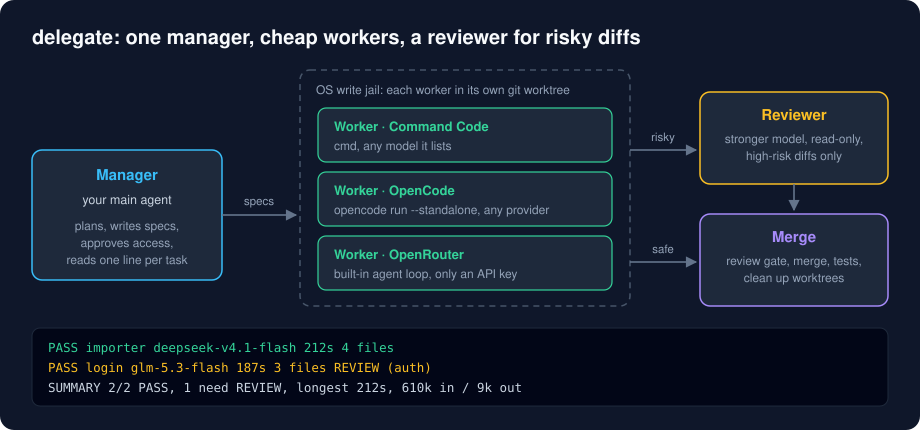

# delegate

A skill that turns your AI coding agent into a manager: it splits a large task, hands the pieces to cheap models running in sandboxed git worktrees, has a stronger model review the risky diffs, and merges the result.



Workers can run through **Command Code**, **OpenCode** or **OpenRouter** (or a mix), so you can use whichever you already pay for.

## Set it up with your AI agent

Paste this to your coding agent (Claude Code, OpenCode, Command Code, or any agent that can run shell commands):

```
Clone https://github.com/manikpruthi/delegate and follow INSTALL.md to set it up for me.
```

[INSTALL.md](INSTALL.md) is written for agents. It tells the agent what to check, what to copy, and where it must stop and ask you: which backend to use, which models, and anything that needs installing. It never asks you to paste an API key into the chat.

## Features

- **Manager / worker / reviewer split.** Your main agent plans and verifies. Cheap models write the code. A stronger model reviews only the changes that are risky.
- **Three worker backends.** `commandcode` (the `cmd` CLI), `opencode` (the `opencode` CLI) and `openrouter` (a built-in, dependency-free agent loop that needs only an API key). Mix them in one swarm.
- **OS-enforced write jail.** Each worker runs under macOS `sandbox-exec` (or Linux `bwrap`) and can write only to its own git worktree. `~/.ssh`, `~/.gnupg` and `~/.aws` are not readable.
- **Scope check.** Each spec lists the files a worker may change. Anything else turns the result into `SCOPE_VIOLATION`.
- **Risk detection.** Changes touching auth, crypto, network parsing, SQL, deletes, concurrency or credentials are marked high-risk from the diff itself. Patterns are in an editable text file.
- **Review gate.** A high-risk task cannot be merged until the reviewer approves the exact diff that is in the worktree.
- **Watchdog.** Wall-clock and idle timeouts kill a stuck worker and its child processes; partial work is kept.
- **Small manager context.** The manager makes one call per stage and reads one line per task, which is where most of the cost of a long agent session goes.
- **Racing and routing.** Run the same task on two models and keep the better diff. A local scoreboard records pass rate, time and tokens per model.
- **Offline test suite.** `tests/run.sh` runs the whole flow against a mock model with no network and no cost.

## Requirements

- macOS (tested on Apple silicon). Linux with `bubblewrap` is supported but experimental. Windows only through WSL2.
- `git`, `bash` 3.2+, Python 3.8+ (standard library only).
- At least one worker backend:
  - an [OpenRouter](https://openrouter.ai) API key, or
  - the [Command Code](https://commandcode.ai) CLI, logged in, or
  - the [OpenCode](https://opencode.ai) CLI with a provider configured.
- A reviewer: the Claude Code CLI (`claude`), or any model on the backends above.
- A manager agent that can load a `SKILL.md` folder and run shell commands. Built for Claude Code; the instructions are written to work in other agents too.

## Install

**With an agent (recommended):** use the prompt above.

**By hand:**

```bash
git clone https://github.com/manikpruthi/delegate.git
```

```bash
cd delegate && ./install.sh ~/.claude/skills/delegate
```

Then copy `config.example.json` to `config.json` in the installed folder, replace the example model ids with ones your backend lists, and run `doctor.sh` there until it prints `RESULT: ready`. For OpenRouter, put the key in `~/.config/delegate/env` as `OPENROUTER_API_KEY=...` (mode 600), or export it in your shell.

Other skill folders: `~/.config/opencode/skills/delegate` (OpenCode), `~/.commandcode/skills/delegate` (Command Code).

There is nothing to build.

## Permissions

- **Sandbox.** macOS `sandbox-exec` is built in and needs no setup. On Linux install `bubblewrap`.
- **Network.** Workers call their model provider, so repository content you delegate is sent to that provider.
- **Git.** `merge.sh` commits and merges locally with the repository's own git identity. It never pushes.
- **Extra write access.** If a worker needs a path outside its worktree it must stop and ask. The manager approves paths inside the repo or your `trusted_roots`, always refuses key and system folders, and asks you about anything else.

## Usage

In your manager agent:

| You type | What happens |
|---|---|
| `/delegate <task>` | The manager lists your model presets and asks which to use |
| `/delegate @deepseek <task>` | Uses that preset, no question |
| `/delegate @deepseek,or-glm <task>` | Mixed swarm, tasks alternate between the models |

The manager decides first whether the task is worth delegating; small tasks or ones that need the whole picture it does itself.

The scripts can also be run directly:

| Command | Purpose |
|---|---|
| `doctor.sh` | Check the setup. `--models` lists presets and whether each is available |
| `swarm.sh <repo> <manifest>` | Run all workers in parallel; one line per worker plus a summary |
| `review.sh <repo> <task>...` | Review high-risk tasks; `a+b` keeps two tasks in one batch |
| `merge.sh <repo> --test "<cmd>" <task>...` | Review gate, commit, merge, run tests, clean up |

A manifest line is `<model> <task> <spec-file> [options]`, where `<model>` is a preset alias or `backend:model-id`:

```
deepseek                         importer  .delegate/specs/importer.md  type=feature
openrouter:z-ai/glm-5.3-flash    reports   .delegate/specs/reports.md   type=feature timeout=1800
```

Options: `type=`, `effort=`, `tag=` (race the same task on two models), `allow=` (approved extra paths), `timeout=`, `idle=`, `turns=`.

`config.json`:

```json
{
  "presets": {
    "deepseek": { "backend": "commandcode", "model": "deepseek/deepseek-v4.1-flash", "label": "DeepSeek via Command Code" },
    "or-glm":   { "backend": "openrouter",  "model": "z-ai/glm-5.3-flash",           "label": "GLM via OpenRouter" }
  },
  "default": "deepseek",
  "reviewer": { "backend": "claude", "model": "claude-opus-5-5", "effort": "medium" },
  "trusted_roots": []
}
```

| Environment variable | Meaning |
|---|---|
| `OPENROUTER_API_KEY` | Key for the `openrouter` backend (or put it in `~/.config/delegate/env`) |
| `OPENROUTER_BASE_URL` | Another OpenAI-compatible endpoint instead of OpenRouter |
| `DELEGATE_CONFIG` | Path to a different `config.json` |
| `DELEGATE_REVIEW_BACKEND`, `_MODEL`, `_EFFORT` | Override the reviewer for one run |
| `DELEGATE_NO_SANDBOX=1` | Run workers without a write jail when no sandbox tool exists. Not recommended |

## How it works

1. **Plan.** The manager reads only enough code to define file boundaries, splits the work into 2–4 tasks with disjoint files, and writes one spec per task (`Task`, `Context`, `Files allowed`, `Acceptance`, optional `Risk`).
2. **Swarm.** `swarm.sh` starts one `worker.sh` per task. Each creates a git worktree on a `delegate/<task>` branch next to the repo, appends strict working rules to the spec, and runs the backend's agent inside the sandbox with a watchdog.
3. **Collect.** Outside the sandbox the script diffs the worktree, checks every changed file against `Files allowed`, scans the diff with `risk-patterns.txt`, counts blocked writes, and prints one status line: `PASS`, `FAIL`, `SCOPE_VIOLATION`, `NEED_ACCESS`, `TIMEOUT`, `STALLED`, `TURN_LIMIT`, `UNKNOWN` or `ERROR`.
4. **Review.** `review.sh` batches the high-risk tasks and runs the reviewer with a fresh context and no write access. It stores the full review and a hash of the reviewed diff, and prints one verdict line per task.
5. **Merge.** `merge.sh` refuses to merge a high-risk task unless its review ends in `VERDICT: APPROVE` and the hash still matches. Then it commits each worktree, merges the branches one by one, runs your test command, and removes worktrees and branches only if everything passed.

Backends differ only in `lib.sh` (how the agent is started) and `dg.py` (how its output is normalized). `or_agent.py` is the OpenRouter worker: under 300 lines giving the model `bash`, `read_file`, `write_file` and `edit_file`, or read-only tools for reviews.

How the reviewer is kept read-only depends on its backend: `claude` runs with only Read/Grep/Glob and no project config, `openrouter` gets read tools limited to the repo and worktrees, and `commandcode` / `opencode` run inside the sandbox with nothing writable except a scratch folder.

### Known limitations

- The sandbox is a **write** jail. Workers can read most of the disk and use the network. Do not delegate work in repositories whose contents must not reach the model provider, and keep secrets out of readable project files.
- Per-user temp and cache folders (`~/Library/Caches`, `~/.cache`, `~/.npm`, the system temp folder) and the backend CLI's own state folder stay writable, because toolchains need them.
- Linux (`bwrap`) support was written from the documentation and has not been tested by the author.
- The `opencode` backend has no turn limit or effort option; only the timeouts stop a runaway worker.
- Token and cost figures come from each backend and are not comparable across backends. Command Code reports no cost.
- The model ids in `config.example.json` are examples and will go out of date.

## Project layout

```
delegate/
├── README.md
├── INSTALL.md              setup guide for AI agents
├── install.sh              copies skill/ into an agent's skills folder
├── LICENSE
├── skill/
│   ├── SKILL.md            the manager's instructions
│   ├── swarm.sh            run workers in parallel
│   ├── worker.sh           one sandboxed worker
│   ├── review.sh           batched review of high-risk tasks
│   ├── merge.sh            review gate, merge, test, clean up
│   ├── doctor.sh           setup check and preset list
│   ├── lib.sh              backend adapters and sandbox launcher
│   ├── dg.py               config lookup and output normalization
│   ├── or_agent.py         built-in agent for OpenRouter
│   ├── worker.sb           macOS sandbox profile
│   ├── reviewer-prompt.md  the reviewer's system prompt
│   ├── risk-patterns.txt   what counts as high-risk
│   └── config.example.json
├── tests/
│   ├── run.sh              offline end-to-end test
│   └── mock_openai.py      scripted mock model API
└── docs/screenshots/
    └── overview.svg
```

## License

[MIT](LICENSE)
